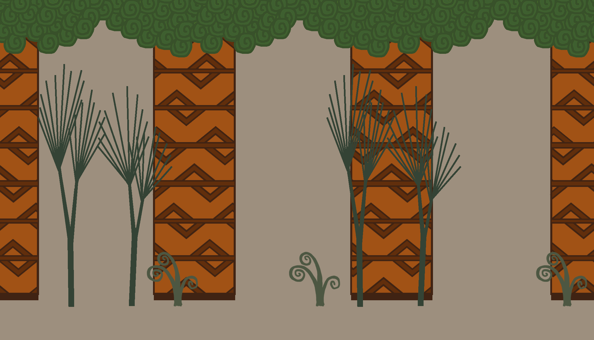

# Upiara e o Espírito Faminto

2D side-scrolling platformer prototype made with GameMaker Studio. You play as Upiara and have to stay ahead of Ceuci, who advances through the forest without stopping.

| Upiara | Ceuci |
|---|---|
|  |  |

## Gameplay

- Ceuci moves right at a constant speed, and the camera follows her, so the screen keeps scrolling.
- Upiara walks slightly faster than Ceuci, so you can pull ahead as long as you get past the platforms and walls.
- If Ceuci catches Upiara, the "Você perdeu" (you lost) screen appears.

## Controls

| Key | Action |
|---|---|
| Left and right arrows | Walk |
| Space | Jump |
| Up and down arrows | Look up or crouch, while standing still |

## Current state

This is an early prototype, and these parts are not finished:

- A "Você ganhou" (you won) screen exists, but nothing in the game leads to it, so the game cannot be won yet.
- There is no sound, menu or restart option.
- A hit animation is included but not used.
- The repository has no ready-to-play build.

## Running the game

1. Install GameMaker Studio 1.x. This project uses the older `.gmx` format, so newer versions of GameMaker may need to import and convert it.
2. Clone this repository.
3. Open `UpiaraV3.project.gmx`.
4. Run the game from the IDE.

## Project structure

- `UpiaraV3.project.gmx` - the GameMaker project file.
- `objects/` - `obj_upiara` (player movement, collision and animation), `obj_ceuci` (chaser and lose condition) and `obj_wall` (solid terrain).
- `rooms/` - `room0` (the level), `room1` (win screen) and `room2` (lose screen).
- `sprites/` - character and terrain sprites.
- `background/` - forest background and win and lose screens.
- `Imagens - Teste/` - source and test images.
